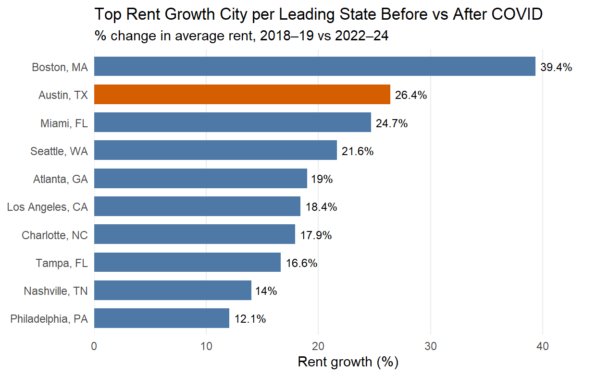
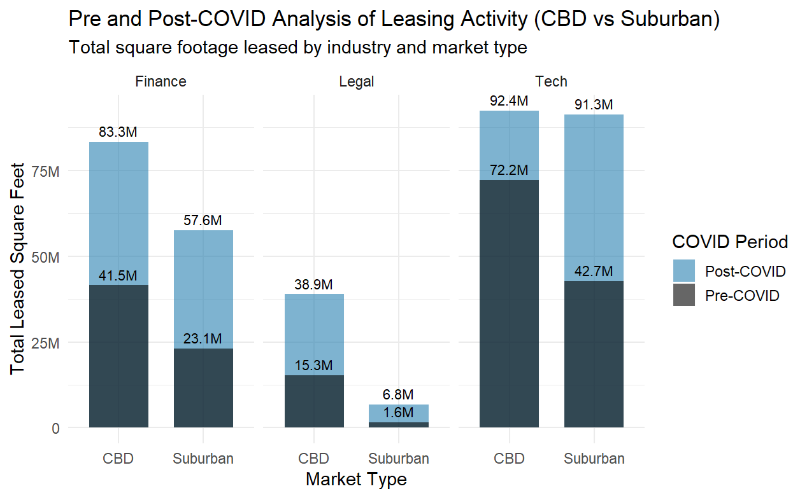
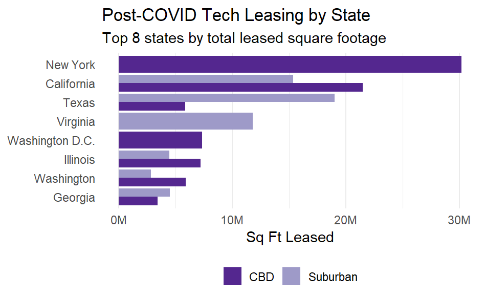
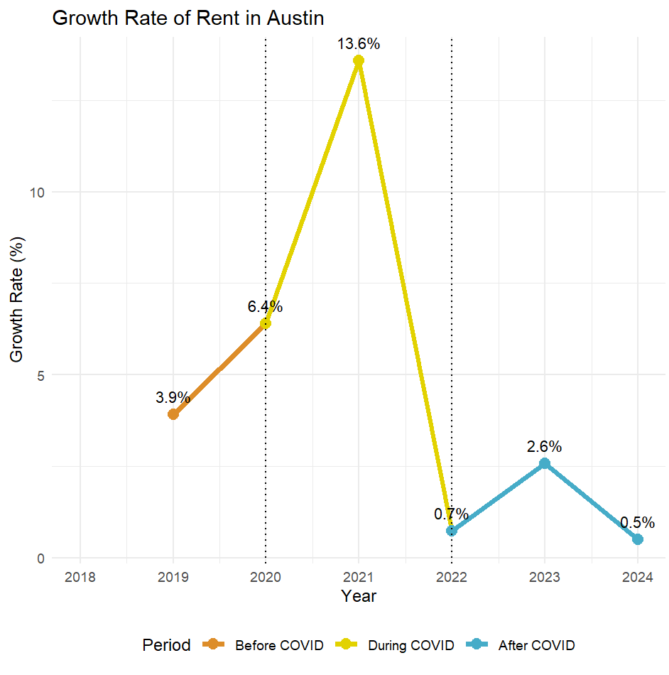

# Commercial Leasing Market Analysis - DataFest 2025

## 1. Project Background
This project was completed as part of **DataFest 2025** by the team **"Data Girlies"**. The dataset was provided by Savills, an international commercial real estate firm that helps to lease office space. The brief was to act as a data analyst identifying notable trends that Savills could use to advise clients in the Tech, Legal, or Financial Services sectors on office leasing decisions as the market recovered from COVID-19. The team's analysis covers leasing activity across multiple US states and cities from 2018 to 2024, spanning the pre-COVID, COVID-transition, and post-COVID periods, and is broken down by industry (Tech, Finance, Legal) and market type (CBD vs Suburban).










## 2. Key Findings
- **Austin, TX** had the 2nd-highest post-COVID rent growth of any market analyzed (26.4%, trailing only Boston at 39.4%), combined with lower lease prices and no state income tax
- Post-COVID, **Tech companies leased more suburban office space than CBD** (91.3M sq ft vs. 72.2M sq ft) which is a clear shift away from downtown cores
- Separately, **San Francisco (-5.7%)** and **New York (-2.0%)** saw rents fall post-COVID which is a sign of continued softening in legacy hubs even as these faster-growing markets took off.
- Austin's growth has cooled sharply since its 2021 peak (13.6%) to just 0.5% by 2024 and that worths monitoring for market normalisation

## 3. Tool used
- R (tidyverse, dplyr, tidyr, ggplot2, stringr, scales, wesanderson): clean and visualise data
- Excel / CSV: format data
- GitHub: illustrate project

## 4. How It Works
1. Cleaned and merged 194,685 lease transaction records (2018–2024) provided by Savills
2. Classified tenants into Tech, Finance, or Legal using keyword matching on industry descriptions
3. Compared pre-COVID (2018–19) vs. post-COVID (2022–24) rent growth and leasing volume by city, industry, and market type (CBD vs. suburban)
4. Built a focused case study on Austin's growth rate to support the final recommendation

## 5. Data Structure
- Datasets
    - **Leases.csv:** (194,685 rows × 35 columns) the main dataset, one row per commercial leasing transaction from January 2018 to December 2024, compiled by Savills from sources including CoStar.
    - **Price_and_Availability_Data.csv:** the same market-level rent and availability fields found in Leases.csv (RBA, available space, rent by internal class), provided separately at one row per market per quarter; already merged into Leases.csv.
    - **Major_Market_Occupancy_Data.csv:** (190 rows × 6 columns) estimated post-pandemic building occupancy for 10 major markets (2020–2024), based on Kastle card-swipe data, indexed to a 1 March 2020 baseline.
    - **Unemployment.csv:** (1,848 rows × 5 columns) monthly state-level unemployment rates from the U.S. Bureau of Labor Statistics (2018–2024).
- Images/charts [`Graphs`](./Graphs)
- Commercial_Leasing_Market_Analysis.Rmd - full analysis + code [`Commercial_Leasing_Market_Analysis.Rmd`](./Commercial_Leasing_Market_Analysis.Rmd)

## 6. How to Run This Project
**Note:** The raw datasets were provided by Savills under a data-use agreement for DataFest 2025 and are not included in this repo. The steps below show how the analysis was run — you'd need access to equivalent data to reproduce the output.

1. **Clone the repository**
   ```
   git clone https://github.com/amynguyen0211/Commercial_Leasing_Market_Analysis
   ```

2. **Install R dependencies**
   ```r
   install.packages(c("tidyverse", "dplyr", 'tidyr', 'ggplot2', "stringr", 'scales', 'wesanderson'))
   ```

3. **Open the analysis file**
   Open `Commercial_Leasing_Market_Analysis.Rmd` in RStudio.

4. **Run the full report**
   Knit the `.Rmd` file to regenerate all charts and findings (requires the original Savills datasets).

## 7. What I would Improve
- Industry classification relied on keyword matching rather than a standardized industry code. Therefore, some leases were excluded for not matching a pattern
- The leading-cities comparison only covers the top 2 cities per state, so smaller markets are not represented
- Would like to use occupancy and unemployment data for a fuller picture of market recovery
